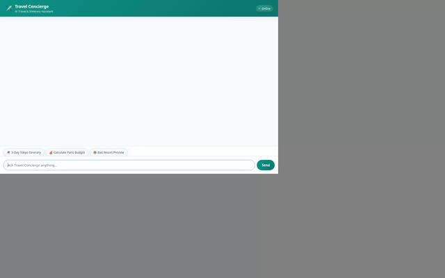

# ✈️ Travel Concierge - AI Travel Assistant

An intelligent, multi-modal travel concierge agent built with Google's **Agent Development Kit (ADK)**, **Vertex AI Agent Platform**, **Firestore**, and **Cloud Storage**. Travel Concierge plans personalized travel itineraries, searches catalog destinations, estimates trip budgets, generates scenic AI preview images & videos, fetches real-time weather and currency exchange rates, and enforces long-term user safety preferences.



---

## 🌟 Implemented Features & Capabilities

Based directly on the implementation in [`travel-concierge/app/agent.py`](file:///config/Desktop/BuildWithGemini/travel-concierge/app/agent.py) and [`travel-concierge/agents-cli-manifest.yaml`](file:///config/Desktop/BuildWithGemini/travel-concierge/agents-cli-manifest.yaml):

### 🧠 Long-Term Memory & User Safety
- **Vertex AI Memory Bank**: Integrates `VertexAiMemoryBankService` (`PreloadMemoryTool`) to remember user preferences across sessions.
- **Safety Callbacks**: Automatically enforces user-registered dietary restrictions, food allergies, and travel constraints in itinerary recommendations.

### 🗃️ Firestore Travel Catalog
- **Catalog Browsing**: `list_destinations_from_catalog` filters destinations by budget and category (beach, culture, luxury, adventure).
- **Keyword Search**: `search_destinations` performs text search across catalog listings.
- **Destination Details**: `get_destination_details` retrieves full details, pricing, and highlights.
- **Catalog Management**: `add_destination_to_catalog` allows adding new travel destinations into Google Cloud Firestore.

### 🎨 Multi-Modal Media Generation (Vertex AI)
- **AI Photo Previews**: `generate_destination_image` uses Vertex AI (`gemini-3.1-flash-lite-image`) to generate custom high-resolution destination photographs, uploads them directly to Google Cloud Storage (`bwg3-qwiklabs-gcp-02-e9f0b61d58c6`), and returns public HTTPS URLs.
- **AI Short Video Previews**: `generate_destination_video` uses Google's Omni model (`gemini-omni-flash-preview`) to generate video clips, saves them as ADK Playground artifacts, uploads them to Google Cloud Storage, and returns public HTTPS URLs.

### 🧮 Secure Code Execution Sandbox
- **Agent Engine Sandbox**: Utilizes `AgentEngineSandboxCodeExecutor` to run Python code securely in an isolated sandbox for budget breakdowns, expense math, and complex travel calculations.

### 🌐 Live External APIs
- **Real-time Weather**: `fetch_live_weather` queries the Open-Meteo REST API for current temperatures, conditions, and forecasts.
- **Currency Conversion**: `convert_currency` queries the Frankfurter FX API for live currency exchange rates.
- **Geocoding & Nearby Places**: `geocode_address` and `find_nearby_places` integrate Google Maps Geocoding & Google Places API (New) for location search and nearby hotel/attraction discovery.

### 🎨 Native A2UI Rendering
- **Basic Catalog v0.8 Cards**: Emits structured A2UI display cards via an `after_model_callback` for rendering interactive visual cards (itineraries, hotel lists, images) in both the ADK dev UI and the custom web frontend.

---

## 🏗️ Architecture & Cloud Infrastructure

| Service | Role / Purpose |
| --- | --- |
| **Vertex AI Agent Runtime** | Hosting and executing the ReAct agent logic (`app/agent.py`) |
| **Vertex AI Memory Bank** | Cross-session long-term memory store (`VertexAiMemoryBankService`) |
| **Vertex AI Code Sandbox** | Secure Python code execution sandbox (`AgentEngineSandboxCodeExecutor`) |
| **Google Cloud Firestore** | NoSQL database storing destination catalog and user travel history |
| **Google Cloud Storage (GCS)** | Public storage bucket (`bwg3-qwiklabs-gcp-02-e9f0b61d58c6`) hosting AI-generated images & videos |
| **Google Maps & Places APIs** | Location geocoding and points of interest search |
| **Cloud Run** | Hosting the production FastAPI proxy and custom chat UI |

---

## 🛠️ Project Structure

```
travel-concierge/
├── app/
│   ├── agent.py               # Main ADK root_agent, tool definitions, & callbacks
│   ├── a2ui_utils.py          # A2UI card renderer & callback utilities
│   └── fast_api_app.py        # Local FastAPI dev server
├── frontend/
│   ├── main.py                # FastAPI proxy server for Cloud Run / local dev
│   ├── requirements.txt       # Frontend dependencies
│   └── static/
│       ├── index.html         # Custom chat frontend with A2UI card renderer
│       └── logo.svg           # Application logo asset
├── agents-cli-manifest.yaml   # Agent deployment manifest & configuration
├── demo.gif                   # Looping video demo recording
├── pyproject.toml             # Python dependencies (ADK, Google Cloud SDKs)
└── project_brief.md           # Workshop project design brief
```

---

## 🚀 Setup & Local Execution

### Prerequisites
- Python 3.11+
- [`uv`](https://docs.astral.sh/uv/) package manager
- `google-agents-cli` (`uv tool install google-agents-cli`)
- Authenticated `gcloud` CLI (`gcloud auth application-default login`)

### 1. Install Dependencies
```bash
cd travel-concierge
agents-cli install
```

### 2. Run in ADK Dev UI (Playground)
To test the agent using the ADK Playground:
```bash
agents-cli playground
```

### 3. Run Custom Web Frontend Locally
Navigate to the `frontend/` directory, set environment variables, and start the proxy server:
```bash
cd travel-concierge/frontend
pip install -r requirements.txt
export AGENT_ENGINE_RESOURCE_NAME="<your-agent-engine-resource-name>"
export AGENT_DIRECTORY="app"
python main.py
```
*(Open your browser to the local port displayed in the server logs, default port 8080).*

---

## 🚢 Cloud Run Deployment

To deploy the frontend proxy to Cloud Run pointing at your deployed Agent Engine resource:

```bash
cd travel-concierge
gcloud run deploy travel-concierge-frontend \
  --source ./frontend \
  --region us-east1 \
  --allow-unauthenticated \
  --set-env-vars="AGENT_ENGINE_RESOURCE_NAME=$AGENT_ENGINE_RESOURCE_NAME,AGENT_DIRECTORY=app"
```

Grant the Cloud Run service account permission to talk to Vertex AI Reasoning Engine:
```bash
gcloud projects add-iam-policy-binding <your-gcp-project-id> \
  --member="serviceAccount:<your-project-number>-compute@developer.gserviceaccount.com" \
  --role="roles/aiplatform.user"
```

---

## 📌 Planned / Future Capabilities

The following features were outlined in initial design briefs but are not yet implemented:
- ✈️ **Live Flight Search API**: Direct GDS flight booking integration (currently handled via travel concierge guidance).
- 🏨 **Live Hotel Reservation API**: Real-time room availability booking (currently handled via Firestore catalog search).
